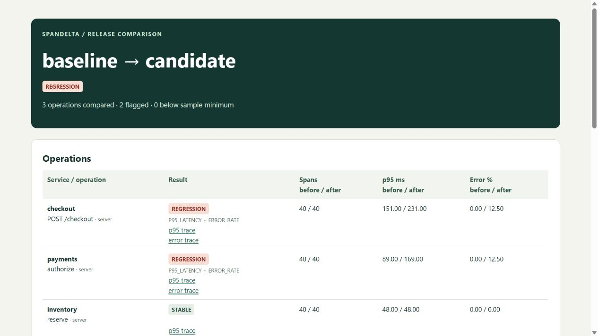

# SpanDelta

Compare two releases using OpenTelemetry traces. SpanDelta reports which operations got slower, how often they failed, and which recorded requests you can inspect to investigate the change.

[](https://github.com/Almeida96/spandelta/actions/workflows/ci.yml)

In the included checkout example, both releases contain 40 requests. Checkout p95 rises from 151 to 231 ms. Payments accounts for an observed 80 ms increase, while inventory stays at 48 ms. The report links the comparison to individual span and trace IDs. You can inspect those spans from the CLI or give an MCP client read access to the same evidence.



## Run the example

Download the ZIP and checksum from the [latest release](https://github.com/Almeida96/spandelta/releases/latest). Extract the archive, set `JAVA_HOME` to a Java 21 installation, and run this command inside the extracted directory.

```sh
bin/spandelta demo --out checkout-demo
```

On Windows use `.\bin\spandelta.bat demo --out checkout-demo`. Choose a new directory. Open `checkout-demo/report.html` in a browser. It includes the comparison, the policy used, and timelines for candidate traces. You can also download the example report directly from the release.

| Observed operation | Baseline p95 | Candidate p95 | Error rate change |
| --- | ---: | ---: | ---: |
| Checkout · POST /checkout | 151 ms | 231 ms | +12.5 pp |
| Payments · authorize | 89 ms | 169 ms | +12.5 pp |
| Inventory · reserve | 48 ms | 48 ms | 0 pp |

These are synthetic fixtures with overlapping child spans. The demo writes both OTLP JSON exports, a SQLite database, the full JSON comparison, and the HTML report. It can run offline.

## Compare your releases

Assign the baseline and candidate different dataset names. Use the same sampling policy and comparable traffic for both captures. Each input file contains one OTLP trace export request in JSON or binary Protobuf.

```sh
bin/spandelta import --db traces.db --dataset before --file before.json
bin/spandelta import --db traces.db --dataset after --file after.pb
bin/spandelta compare --db traces.db --baseline before --candidate after \
  --min-samples 20 --min-delta-ms 10 --min-delta-pct 20 --error-delta-pp 2 \
  --html release-review.html --gate
```

The command prints JSON. With `--gate` it exits **0** for a pass, **2** for a regression, **3** for inconclusive coverage, and **1** for an input or execution error. A baseline operation that disappears or falls below the minimum sample size makes the decision inconclusive unless another operation has already demonstrated a regression. Existing HTML output files are protected against accidental overwrite.

To inspect an example, copy its `traceId` from `candidate.p95Example` or `candidate.errorExample` in the comparison.

```sh
bin/spandelta inspect --db traces.db --dataset after --trace TRACE_ID
```

The timeline includes start offsets, duration and time outside observed direct children. Concurrent child intervals are counted once. Missing parents, multiple roots, cycles and children outside their parent's time range produce warnings. See [how comparisons work](docs/analysis.md).

## Receive live traces

Point an OTLP/HTTP exporter at the loopback receiver. Configure its `Authorization` header with `Bearer` followed by the value of the token variable. The receiver accepts Protobuf or OTLP JSON, with optional gzip.

```sh
export SPANDELTA_TOKEN="$(openssl rand -hex 32)"
bin/spandelta receive --db traces.db --dataset canary \
  --token-env SPANDELTA_TOKEN --port 4318
```

The endpoint is `http://127.0.0.1:4318/v1/traces`. Each receiver writes to one named dataset. Replaying the same retained span is idempotent. A conflicting span ID rejects its entire batch. Other clients can inspect the database while collection is running. See [collector setup, limits and data handling](docs/collector.md).

## Investigate from an AI client

The `mcp` command runs a read-only stdio server over an existing database. Its three tools list datasets, compare releases, and inspect a trace with stable IDs. An agent can use these tools to answer “Which operation regressed, and which trace supports that conclusion?” The server returns measurements and evidence. The connected agent supplies any interpretation.

Use the [client configuration](examples/mcp-client.json) or run the [official SDK example](examples/agent_investigation.py). The [MCP guide](docs/mcp.md) includes a complete session and a sample question. The example uses an MCP client directly and requires no model credentials.

## Build

Use a JDK 21 and the checked-in Gradle wrapper.

```sh
./gradlew test installDist distZip
build/install/spandelta/bin/spandelta demo --out build/checkout-demo
```

On Windows use `.\gradlew.bat` and `.\build\install\spandelta\bin\spandelta.bat`. CI verifies Linux and Windows, sends real spans through the official OpenTelemetry Java exporter, checks gate exit codes and replay handling, and queries the packaged app through the official MCP Python SDK.

The receiver and analysis engine are written in Kotlin. SQLite stores bounded local datasets, with up to 50,000 spans per dataset. SpanDelta retains service and operation names, timing, identifiers, span kind and status. Arbitrary span attributes, logs, events, and baggage are discarded. See the [release notes](CHANGELOG.md) and [license](LICENSE).
